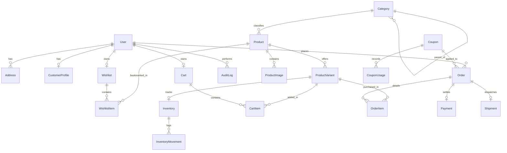

# SAAJNIKA — PostgreSQL Database Architecture & ER Documentation

This document describes the relational schema implemented across the 11 Django apps in **SAAJNIKA**.

## Schema Entities (25 Core Models)

### 1. User (`apps.accounts.User`)
* Primary key: `id` (BigAuto)
* Attributes: `email` (Unique), `first_name`, `last_name`, `phone`, `role` (`CUSTOMER`, `ADMIN`, `STAFF`), `is_verified`, `is_staff`, `date_joined`.

### 2. CustomerProfile (`apps.accounts.CustomerProfile`)
* Attributes: `user_id` (OneToOne), `avatar`, `date_of_birth`, `loyalty_tier`.

### 3. Address (`apps.accounts.Address`)
* Attributes: `id` (UUID), `user_id` (FK), `full_name`, `phone`, `address_line1`, `address_line2`, `landmark`, `city`, `state`, `pincode`, `address_type`, `is_default`.

### 4. Category (`apps.catalog.Category`)
* Attributes: `id` (UUID), `name` (Unique), `slug` (Unique), `tagline`, `description`, `image_url`, `parent_id` (Self FK), `display_order`, `is_active`.

### 5. Product (`apps.catalog.Product`)
* Attributes: `id` (UUID), `name`, `slug` (Unique), `sku` (Unique), `category_id` (FK), `collection_name`, `base_price`, `sale_price`, `short_description`, `description`, `fabric_and_care`, `fit_and_sizing`, `shipping_and_returns`, `is_featured`, `is_new_arrival`, `is_active`, `meta_title`, `meta_description`.

### 6. ProductImage (`apps.catalog.ProductImage`)
* Attributes: `id` (UUID), `product_id` (FK), `image_url`, `alt_text`, `is_primary`, `display_order`.

### 7. ProductVariant (`apps.catalog.ProductVariant`)
* Attributes: `id` (UUID), `product_id` (FK), `sku` (Unique), `size` (`XS`, `S`, `M`, `L`, `XL`, `XXL`, `FREE`), `color_name`, `color_hex`, `additional_price`, `stock_quantity`, `low_stock_threshold`, `is_active`.
* Constraint: Unique `(product_id, size, color_name)`.

### 8. Inventory (`apps.inventory.Inventory`)
* Attributes: `id` (UUID), `variant_id` (OneToOne), `stock_quantity`, `reserved_quantity`, `low_stock_threshold`.

### 9. InventoryMovement (`apps.inventory.InventoryMovement`)
* Attributes: `id` (UUID), `inventory_id` (FK), `change_type` (`RESTOCK`, `PURCHASE`, `RETURN`, `ADJUSTMENT`), `quantity`, `reason`, `reference_id`, `created_by_id` (FK User).

### 10. Cart (`apps.cart.Cart`)
* Attributes: `id` (UUID), `user_id` (FK Nullable), `session_key` (Index), `created_at`, `updated_at`.

### 11. CartItem (`apps.cart.CartItem`)
* Attributes: `id` (UUID), `cart_id` (FK), `variant_id` (FK), `quantity`, `unit_price`.

### 12. Wishlist (`apps.wishlist.Wishlist`)
* Attributes: `id` (UUID), `user_id` (OneToOne).

### 13. WishlistItem (`apps.wishlist.WishlistItem`)
* Attributes: `id` (UUID), `wishlist_id` (FK), `product_id` (FK).

### 14. Coupon (`apps.coupons.Coupon`)
* Attributes: `id` (UUID), `code` (Unique), `discount_type` (`PERCENTAGE`, `FIXED`), `discount_value`, `min_order_value`, `max_discount_amount`, `valid_from`, `valid_to`, `usage_limit`, `per_user_limit`, `times_used`, `is_active`.

### 15. CouponUsage (`apps.coupons.CouponUsage`)
* Attributes: `id` (UUID), `coupon_id` (FK), `user_id` (FK), `order_id` (UUID), `discount_applied`, `used_at`.

### 16. Order (`apps.orders.Order`)
* Attributes: `id` (UUID), `order_number` (Unique, e.g. `SJ-XXXXXX`), `user_id` (FK Nullable), `guest_email`, `guest_phone`, `status` (`CREATED`, `PAYMENT_PENDING`, `PAID`, `PROCESSING`, `PACKED`, `SHIPPED`, `OUT_FOR_DELIVERY`, `DELIVERED`, `CANCELLED`, `RETURN_REQUESTED`, `RETURNED`, `REFUNDED`), `subtotal`, `discount_amount`, `shipping_fee`, `tax_amount`, `total_amount`, `coupon_id` (FK Nullable), `shipping_address` (Frozen JSON snapshot), `billing_address` (JSON), `customer_notes`, `internal_admin_notes`, `cancel_reason`.

### 17. OrderItem (`apps.orders.OrderItem`)
* Attributes: `id` (UUID), `order_id` (FK), `variant_id` (FK Nullable), `product_name`, `sku`, `size`, `color`, `unit_price`, `quantity`, `total_price`, `image_url`.

### 18. Payment (`apps.payments.Payment`)
* Attributes: `id` (UUID), `order_id` (OneToOne), `provider` (`RAZORPAY`, `COD`), `transaction_id`, `razorpay_order_id`, `razorpay_payment_id`, `razorpay_signature`, `status` (`PENDING`, `SUCCESS`, `FAILED`, `REFUNDED`), `amount`, `currency`, `verified_at`.

### 19. PaymentWebhookEvent (`apps.payments.PaymentWebhookEvent`)
* Attributes: `id` (UUID), `event_id` (Unique Index), `event_type`, `payload` (JSON), `is_processed`, `processed_at`, `error_log`.

### 20. Shipment (`apps.shipping.Shipment`)
* Attributes: `id` (UUID), `order_id` (OneToOne), `provider`, `courier_name`, `tracking_number` (Unique), `tracking_url`, `current_status`, `estimated_delivery`, `shipped_at`, `delivered_at`.

### 21. Notification (`apps.accounts.Notification`)
* User notification events for order transitions.

### 22. NewsletterSubscriber (`apps.cms.NewsletterSubscriber`)
* Attributes: `id` (UUID), `email` (Unique), `is_active`, `subscribed_at`.

### 23. HomepageBanner (`apps.cms.HomepageBanner`)
* Attributes: `id` (UUID), `banner_type` (`HERO`, `EDITORIAL`, `FEATURED_GRID`, `ANNOUNCEMENT`), `kicker`, `title`, `subtitle`, `cta_text`, `cta_link`, `image_url`, `display_order`, `is_active`.

### 24. StoreSetting (`apps.cms.StoreSetting`)
* Attributes: `key` (Unique), `value`, `description`.

### 25. AuditLog (`apps.audit.AuditLog`)
* Attributes: `id` (UUID), `user_id` (FK Nullable), `action`, `entity_type`, `entity_id`, `ip_address`, `details` (JSON), `timestamp`.
